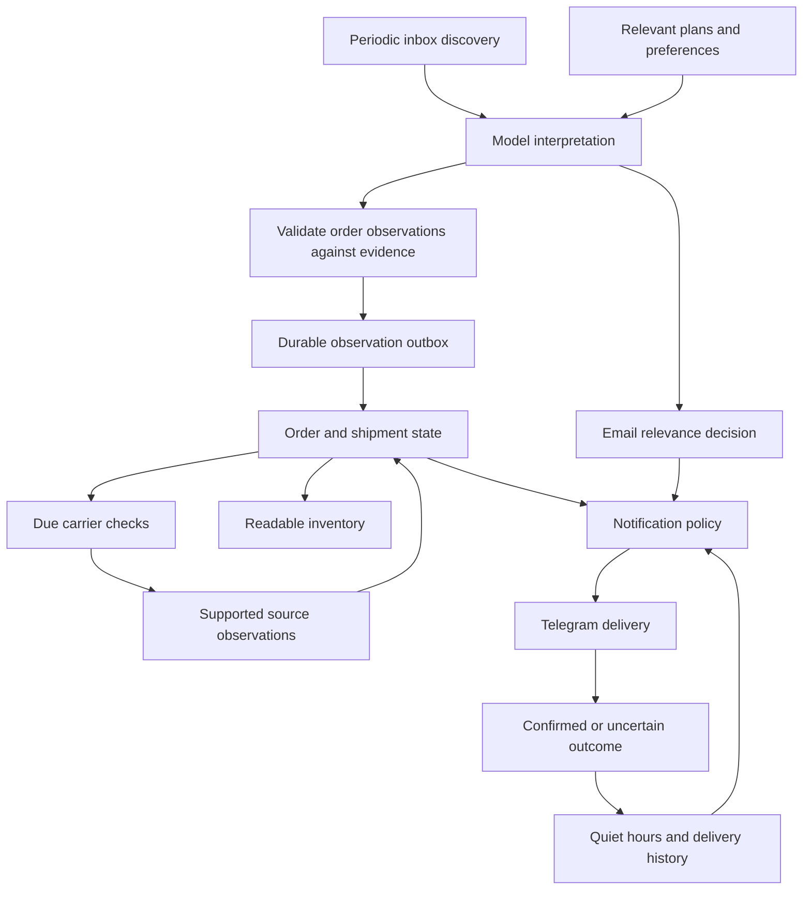
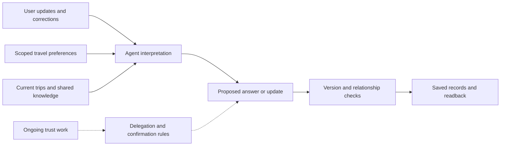
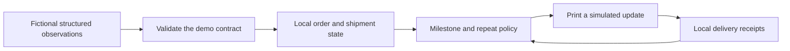

# Reasoning, state and action have different jobs

This conceptual diagram shows the private email/order workflow without deployment
addresses, account details or operational records.

A model interprets meaning. Code validates the declared facts, associates known
references and maintains state. The transport records what happened when sending.
These responsibilities prevent a persuasive sentence from being the only record
that something happened.

The email pipeline maintains its own operational store and readable ledger.
Travel uses typed Markdown records and checked updates. They do not share a
fictional universal database, and this diagram does not imply that every private
integration has been unified into one writer.

## Travel preferences and the trust work

The dotted links describe the complementary trust direction, not a claim that
every travel action already passes through a complete trust layer. The
[travel case](TRAVEL_CASE_STUDY.md) distinguishes current behavior from that work.

## Public demo boundary

The public fixture replaces both email interpretation and courier retrieval.
SQLite stores synthetic operational state. There is no model, inbox reader,
browser, Telegram adapter, real knowledge base or trust engine in the demo.
Its tests exercise the stated local contract, not the quality of upstream
interpretation or the behavior of external services.
