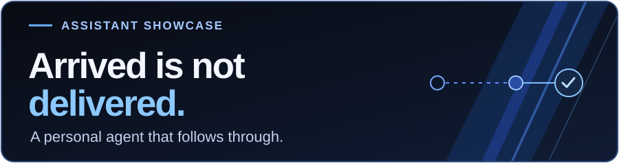

<p align="center">
  
</p>

<p align="center">
  <a href="#trust-and-anticipation">The design</a> · <a href="#one-behavior-you-can-test">Run the demo</a> · <a href="VERIFICATION.md">Evidence and limits</a>
</p>

## Trust and anticipation

I’m building a personal assistant that can notice what matters before I ask, without assuming that noticing something gives it permission to act.

- **Trust: earn permission one kind of action at a time.** Knowing my hotel preferences is not permission to book or cancel. The prototype tracks authority by action and context so that a success, mistake or revocation affects only the relevant permission. The mechanism has offline tests; broader live enforcement is still in progress.
- **Anticipation: speak when the update changes what I can do.** The assistant already follows selected workflows in daily use. The next step is to carry open tasks across conversations, surface changes while there’s time to act, and stay quiet when nothing has changed. That broader task and follow-up system is still in design.

I define the behavior, test it in daily use and decide what to change. Coding agents propose designs and implement and test the software. [Who did what](CONTRIBUTIONS.md)

## One behavior you can test

Package tracking is one example, not the whole assistant. A courier’s warehouse scan once sounded like a confirmed check-in. I caught it and made that distinction a requirement: **arrival keeps the order open; final delivery closes it; replaying old evidence should not notify me again.**

With Python 3.11+, run these two commands against the same fresh demo database:

```sh
python demo/assistant_demo.py --state .demo-state/showcase.sqlite3 --scenario delivered
python demo/assistant_demo.py --state .demo-state/showcase.sqlite3 --scenario delivered
```

The second run reports `"notifications": 0`. This uses fictional data, sends no messages, and does **not** run the trust or anticipation systems.

[Package case study](CASE_STUDY.md) · [Travel preferences and scoped trust](TRAVEL_CASE_STUDY.md) · [Architecture](ARCHITECTURE.md)
