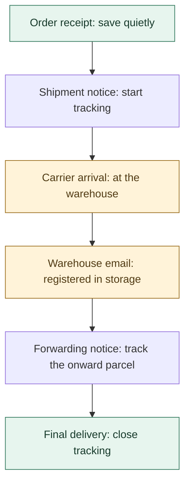

# Assistant Showcase

<p align="center">
  
</p>

**A personal assistant developed through human direction, coding agents and feedback from everyday use.**

I defined the workflows, tested the assistant in use and refined its behavior.
Coding agents proposed technical designs, implemented the code and ran automated checks.

## From email to follow-through

An inbox summary still leaves the tracking to me. The goal: remember the order,
follow its progress and surface useful changes.

The **offline synthetic demo** makes the important distinctions visible:



Warehouse arrival is not registration or final delivery. Repeated observations
do not create repeat alerts; uncertain sends remain held.

## Two case studies

| Case | What I shaped |
| --- | --- |
| **[Email → package tracking](CASE_STUDY.md)** | Useful alerts, concise order names and source-backed milestones |
| **[Travel → reusable preferences](TRAVEL_CASE_STUDY.md)** | Defaults, exceptions and alternatives that reduce repeated decisions |

The travel case also introduces **scoped trust**, a separate offline-tested
prototype with live integration still in progress.

## Try it

Python 3.11+. No dependencies, API keys or network access.

```sh
python demo/assistant_demo.py --scenario delivered
python -m unittest discover -s tests -v
```

**12 synthetic tests passed.** Extraction and naming are supplied as fictional
inputs; this demo does not measure AI accuracy or exercise live services.
[Stages, replay and failure scenarios →](demo/README.md)

[Architecture](ARCHITECTURE.md) · [Who did what](CONTRIBUTIONS.md) · [Evidence and limits](VERIFICATION.md)

Newly written showcase code and synthetic data only. The private assistant's
source, history and live records are not included.
