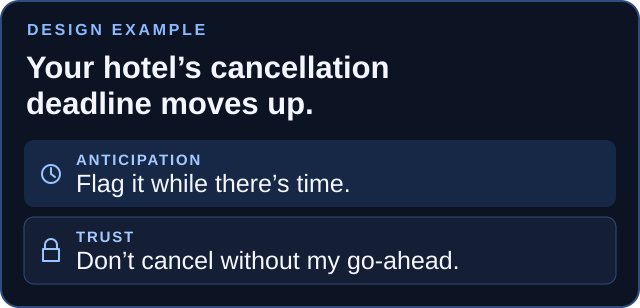

  

  <a href="demo/README.md">Run the parcel demo</a> · <a href="ARCHITECTURE.md">How it works</a> · <a href="VERIFICATION.md">Evidence</a>

  

**Today:** Selected workflows are live. Scoped trust is a tested prototype; broader anticipation is still in design. The [offline parcel demo](demo/README.md) shows one working behavior, not the full system.

I set the requirements and tested them in daily use. Coding agents implemented the software. [Contributions](CONTRIBUTIONS.md) · [Travel case study](TRAVEL_CASE_STUDY.md)
