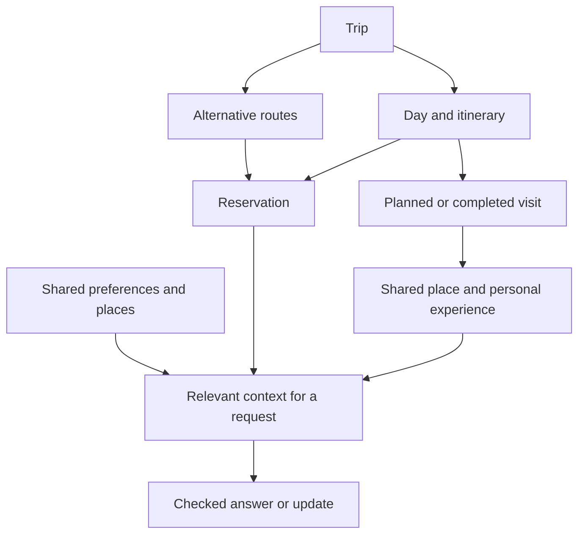

# Travel knowledge: carrying preferences, not just storing bookings

## The work I wanted to offload

A useful travel assistant should not make me restate the same planning defaults
or reconstruct the consequences of every change. It should remember what is
generally true for me, recognize when a particular trip is an exception, and keep
unresolved choices separate from decisions I have actually made.

I chose a readable knowledge base organized around trips and days, with shared
places, preferences and experiences outside individual trips. Coding agents
translated that direction into typed records, links, retrieval guidance and
checked update tools.

## Turning preferences into rules the agent can reuse

| Preference or intent I supplied | Reusable behavior | What it must not imply |
| --- | --- | --- |
| Assume one hotel guest unless I explicitly say otherwise | Retrieve that saved default when a new booking omits occupancy | A different recorded guest count changed, or I paid the whole bill |
| Keep alternative bookings until I choose a route | Preserve options and shared bookings; identify affected reservations after a choice | A suggestion to cancel is an actual supplier cancellation |
| Keep places and past experiences reusable across trips | Link a trip's plans and visits to shared place records | Planning to visit proves I went, or one bad experience is a universal property fact |
| Distinguish ongoing preferences from a one-trip exception | Scope guidance and retain the original general preference | A temporary choice silently rewrites how all future trips should be planned |
| A known purchase total can be enough | Preserve the supported total without demanding a reconstruction of every item | Missing item details are known or unrelated obligations have disappeared |

These rules move recurring interpretation work into the assistant. They are not
all hard-coded defaults: the agent retrieves relevant preferences and applies
them to the current request, while code validates record types, links and updates.
The user supplies the intent; the harness makes that intent available and checks
the proposed changes. This is persistent context and policy, not model training.

The one-guest rule is a concrete example with a recorded managed write and
readback. It also illustrates why scope matters: occupancy is evidence about
guests, not about payment, cost sharing or cancellation terms.

## Keep the relationships that make those rules useful

A reservation is stored once and referenced where needed. Its booking state and
route relevance are distinct. Selecting a different route can change which
reservations are useful without claiming that any supplier booking has changed.
Shared preferences and experiences stay available after an individual trip ends.

## The test that mattered: did the preference affect the result?

Using the assistant during a trip exposed a gap: successfully saving information
does not establish that a later answer or itinerary used it. A post-trip review
found semantic omissions even when the stored records were structurally valid.

I requested the review and the update-procedure upgrade. Agents implemented
guidance to treat a message as both a question and a possible factual update,
retrieve related records, preserve unaffected details, and check the saved result
against the affected view. Hypothetical questions remain non-mutating.

Fixture and restricted fictional model trials verified specific revised cases.
They do not prove every future conversation will capture and apply every preference;
ordinary-use acceptance remained a separate step at the recorded upgrade checkpoint.
No measured reduction in repeated questions or user effort is claimed here.

## Complementary work in progress: scoped trust

Preferences answer **what would suit me**. Trust and authorization answer
**what the assistant may do without asking again**. A useful assistant needs
both: remembering that I prefer a route is not permission to buy or cancel it.

I am researching and prototyping how the assistant should earn, retain and lose
scoped autonomy. The current separate prototype includes:

- Permissions tied to an action and context, rather than one global confidence
  score that grants broad access.
- Explicit owner decisions bound to the proposed scope, with caps and restrictions.
- Recorded successful outcomes that can increase eligible autonomy within those
  limits, and mistakes or revocations that can narrow the relevant authority.
- A distinction between preference corrections and execution or judgment failures.
- Inspectable tool/action declarations and a check of current authority at dispatch.

Coding agents implemented the local service, persistent records and test tooling.
The current release has recorded offline verification. Native integration, wider
tool coverage and live acceptance are still in progress; declaration support does
not mean every tool already enforces the new contract. This work changes the
harness's policy state, not the model's weights, and does not provide an operating
system sandbox.

The intended complement is straightforward: the knowledge base carries the
preference, the agent proposes a suitable action, the applicable authority limits
what can proceed, and the outcome becomes evidence for later decisions. That
complete travel/trust path is a direction being implemented, not a shipped claim
or a feature of the public email demo.

For the runnable example and its limits, see the [email case](CASE_STUDY.md) and
[verification notes](VERIFICATION.md).
